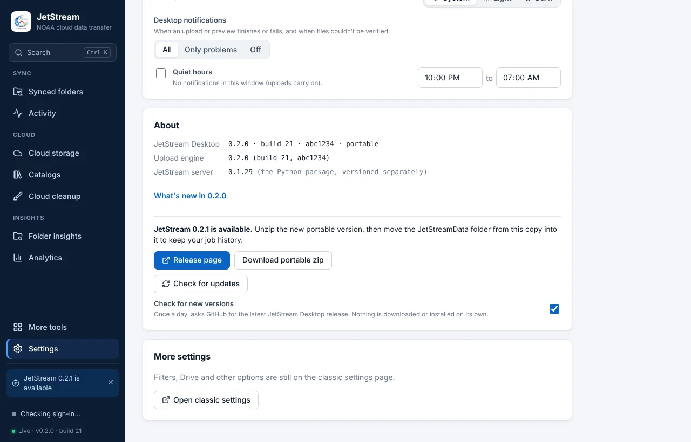

# Download and install

The latest release is always on the [Releases page](https://github.com/akridge/jetstream/releases/latest).
Builds of every change are also available from [GitHub Actions](https://github.com/akridge/jetstream/actions/workflows/desktop.yml) (open the latest green run and scroll to **Artifacts**).

## Windows

=== "Portable (recommended)"

    `JetStream-<version>-windows-x64-portable.zip`

    1. Unzip it anywhere: your Documents folder, a shared drive, or a USB stick.
    2. Run **JetStream.exe**. Nothing is installed, and no administrator rights are needed.

    Job history, logs and the upload manifest stay in the **JetStreamData** folder next to the program, so the whole folder can travel with you.

=== "Installer"

    `JetStream_<version>_x64-setup.exe` or `JetStream_<version>_x64_en-US.msi`

    Adds JetStream to the Start menu. Data is kept in `%LOCALAPPDATA%\JetStream`.

!!! note "Windows protected your PC"
    JetStream isn't code-signed yet, so Windows SmartScreen (and sometimes Chrome) warns about it.
    Choose **More info → Run anyway**. Signing is planned.

Windows 10 and 11 include the WebView2 runtime JetStream needs.

## Linux

=== ".deb (Debian, Ubuntu)"

    ```bash
    sudo apt install ./JetStream_<version>_amd64.deb
    ```

    Installs JetStream with what it needs (WebKitGTK 4.1). Ubuntu 22.04 or newer.

=== "AppImage (most distributions)"

    ```bash
    chmod +x JetStream_<version>_amd64.AppImage
    ./JetStream_<version>_amd64.AppImage
    ```

=== "Portable zip"

    `JetStream-<version>-linux-x64-portable.zip`: unzip and run `./JetStream`.
    Needs WebKitGTK 4.1 (`sudo apt install libwebkit2gtk-4.1-0` on Ubuntu and Debian).

The tray icon needs a desktop with AppIndicator support (on GNOME, the AppIndicator extension).

## You'll also need

- **Google Cloud SDK** (`gcloud`) for signing in with your Google account: [install it](https://cloud.google.com/sdk/docs/install). JetStream tells you if it's missing.
- Access to a Google Cloud Storage bucket. See [For IT and admins](admins.md#permissions) for the permissions.

## Updating

JetStream checks once a day for a newer release and says so at the bottom of the sidebar and in **Settings → About**, with links to download it. Nothing is downloaded or installed on its own.

- **Installer:** run the new installer.
- **Portable:** unzip the new version, then move the **JetStreamData** folder from the old copy into it to keep your history.

After an update, JetStream shows **What's new** once.

{ .screen }
