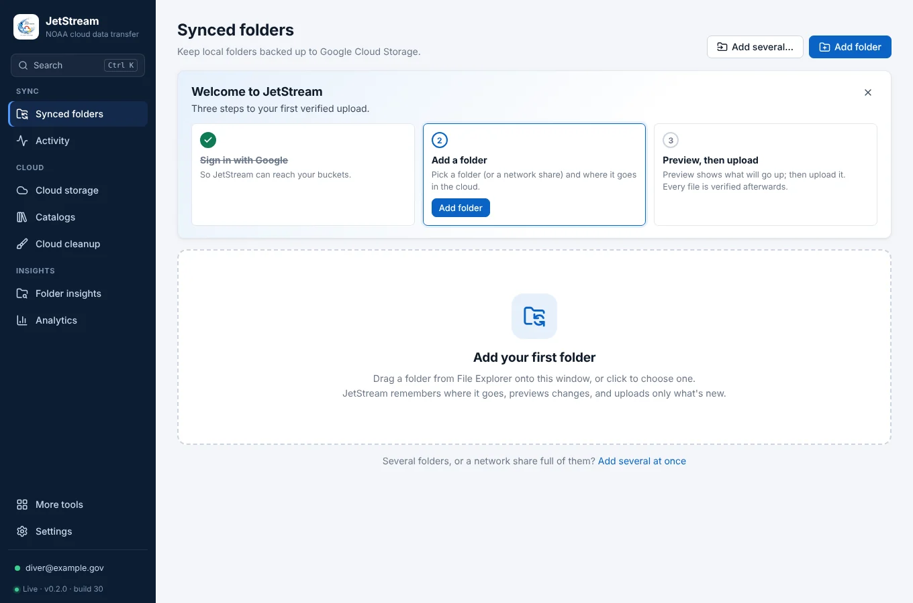
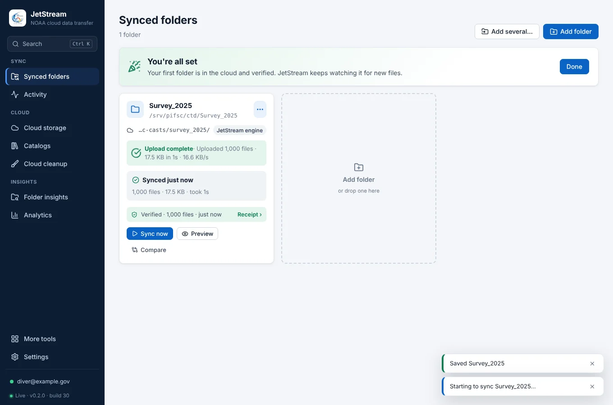

# Your first upload

A new install walks you through three steps, ticking them off as you go.

{ .screen }

## 1. Sign in with Google

Open **Settings → Sign in with Google**. A browser window opens for your usual Google sign-in. JetStream then uses that account (and only that account) to reach your buckets.

## 2. Add a folder

Click **Add folder** (or drag a folder from File Explorer onto the window) and choose:

- **The folder** on this computer, a network share (`\\server\share\project` works) or an external drive.
- **Where it goes:** a bucket and folder, like `gs://pifsc-data/surveys/2025/`.
- **How to upload:** the **JetStream engine** (recommended: faster, pausable, verified) or **gcloud**.
- Optional: upload new files automatically, a schedule, files and folders to skip.

!!! tip "Lots of folders?"
    **Add several…** lists the folders inside a folder or network share with a tick box each, and adds the ones you pick in one go.

## 3. Preview, then upload

**Preview** shows exactly what would upload, without uploading anything. When it looks right, **Upload**. The card shows progress, speed and time left; you can **Pause** and **Resume** at any time.

When it finishes, the card says what was uploaded, and JetStream checks every file against the cloud by checksum.

{ .screen }

## What next

- New files are noticed within seconds. Turn on **Upload new files automatically** to have them go up by themselves.
- Open the **receipt** to see the verification. [More about receipts](guides/receipts.md).
- Press ++ctrl+k++ to jump anywhere or run any action by typing.
