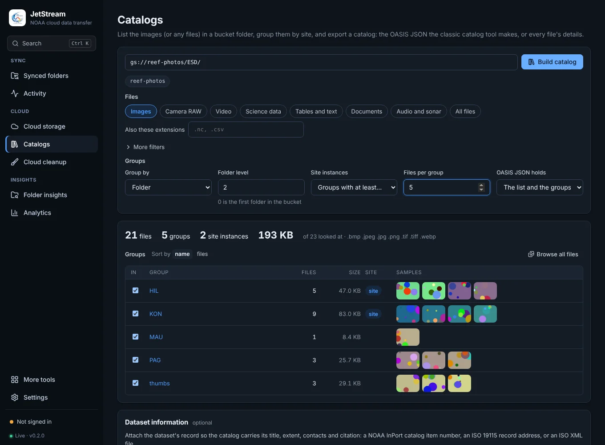
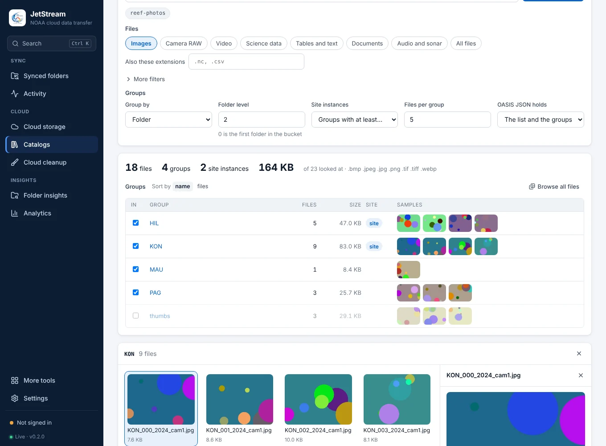

# Catalogs

Build a catalog of the images (or any files) in a bucket folder, grouped by site, and export it for OASIS or with every file's details. Open **Catalogs** in the sidebar, or right-click a folder in Cloud storage → **Make a catalog…**.

{ .screen }

## Files

**Images** by default (JPEG, PNG, TIFF, BMP, WebP). Add Camera RAW, Video, Science data (NetCDF, HDF5, Zarr, Parquet, GRIB, …), Tables and text, Documents, or Audio and sonar, choose **All files**, or list your own extensions. **More filters** narrows by file name, path, folders to skip (like `thumbs`) and depth. There's no 50,000-file limit.

## Groups

Group by the start of the file name, by folder level, by a regular expression, or by your own list. Site instances can be groups with at least N files, groups that are a folder, groups with a file matching a pattern, or groups you tick. The bucket is listed once, so changing any of this updates the result straight away.

Each group shows its file count, size and sample thumbnails. Click a group to browse its files with the preview pane; untick one to leave it out.

{ .screen }

## Export

- **Save OASIS JSON:** exactly the file the classic catalog tool writes (`instances`, `instances_grouped`, `site_instances`).
- **Detailed CSV / JSON:** every file with its group, size, type, original dates, upload time, checksums and storage class.
- **Save to my catalogs:** keeps it with JetStream; opening it later builds it again from the bucket with the same options.

## Dataset information

Attach the dataset's record: a **NOAA InPort** catalog item number (JetStream reads its ISO 19115 record), any ISO 19115 record address, or an ISO XML file. The title, abstract, time period, area, contacts, keywords, use constraints and DOI go into detailed exports and saved catalogs, and can be saved next to the OASIS JSON. The OASIS JSON itself never changes.
