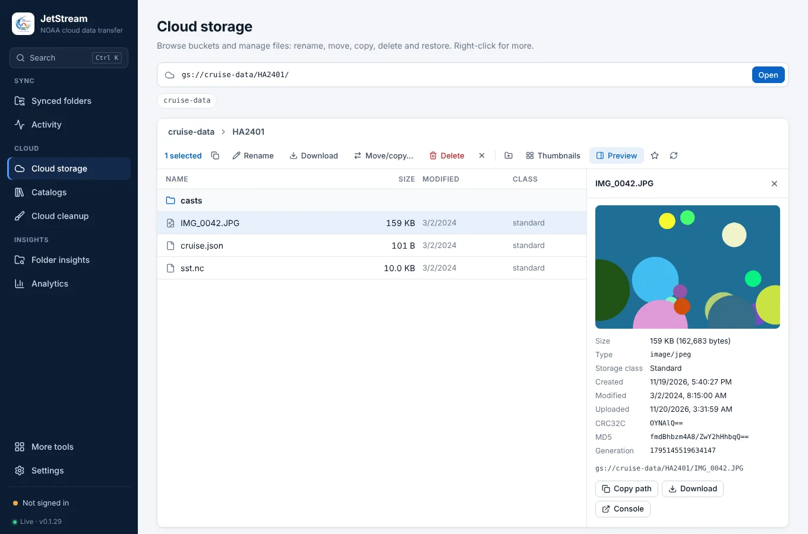
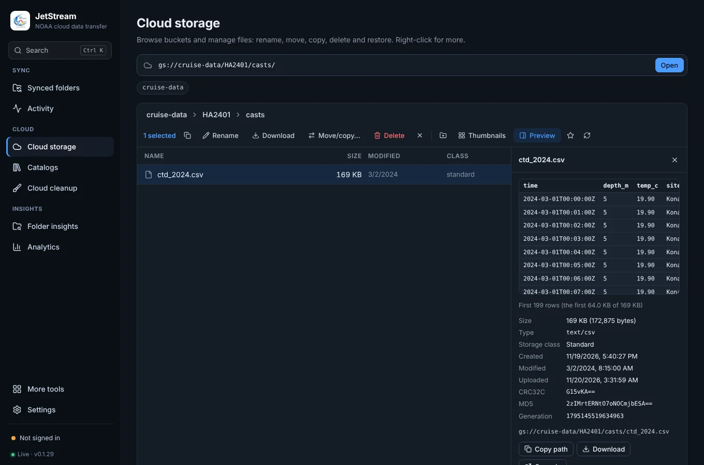

# Cloud storage

A file manager for your buckets.

{ .screen }

## Browsing

- Open a bucket or folder by typing `gs://bucket/folder/`, or pick a recent one.
- **Star** a location (the star in the toolbar) to keep it in the sidebar.
- **Thumbnails** (toolbar) shows images as a grid. Thumbnails are cached (250 MB by default, set in Settings); Nearline, Coldline and Archive images only load when clicked, because retrieving them is charged.
- Select like in Explorer: click, ++ctrl++ or ++shift++ click, arrow keys, right-click for a menu.

## The preview pane

Select a file to see:

- **images** larger
- **CSV and TSV** as a table of the first 200 rows; **text, JSON, XML and logs** as text. Only the first 64 KB is read, however big the file.
- **every detail:** type, size, storage class, original created and modified dates, upload time, CRC32C and MD5, generation and custom metadata

{ .screen }

## Managing files

**Rename** (++f2++), **New folder**, **Move or copy to…**, **Delete** (++del++) and **Download**. Each shows what it involves before running, and copies and moves happen inside Google Cloud (nothing passes through your computer). Drop files or folders onto the window to upload them.

If the bucket keeps deleted files (soft delete), **Recently deleted** lists them for restoring.

## Cleanup

**Cloud cleanup** finds junk left in a bucket: unfinished uploads (`.gstmp`), NAS thumbnail folders, `Thumbs.db`, `.DS_Store`, Office lock files and temporary files. Scanning changes nothing; you choose what to move to quarantine.
