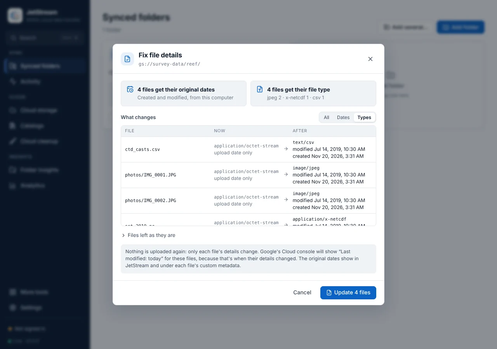

# File details

## What uploads record

Every file the JetStream engine uploads gets:

- **its file type** (`image/jpeg`, `text/csv`, `application/x-netcdf`, …), so browsers and the Cloud console show images and text instead of downloading them
- **its original modified date** (`goog-reserved-file-mtime`, as `gcloud storage rsync` records it)
- **its original created date** (`jetstream-file-created`), where the file system has one

Cloud storage in JetStream shows the original dates; the Cloud console's "Created" and "Last modified" are always the upload times (Google sets them).

## Fix file details for older uploads

Files uploaded by older versions (or other tools) may be missing their type or dates. **Fix file details in the cloud…** (a folder's menu, or right-click a folder in Cloud storage) adds them without uploading anything again.

It all happens in one window:

1. **Checking:** live progress while it lists the cloud folder and compares it with the folder on this computer (**Stop** any time).
2. **Review:** what will change, with before and after for each file.
3. **Updating:** each file's details are updated in place; files changed since the check are left alone.
4. **Done:** what changed, and any files that failed with **Check again**.

{ .screen }

Original dates come from the synced folder on this computer, and only for files that are the same as their cloud copy (checked by checksum). For a cloud folder that isn't synced, **Fix file types…** sets the types only.

!!! info
    Updating details counts as a change in Cloud Storage, so the Cloud console shows "Last modified: today" for those files. The original dates are in JetStream and each file's custom metadata. It needs permission to update objects (`storage.objects.update`).
