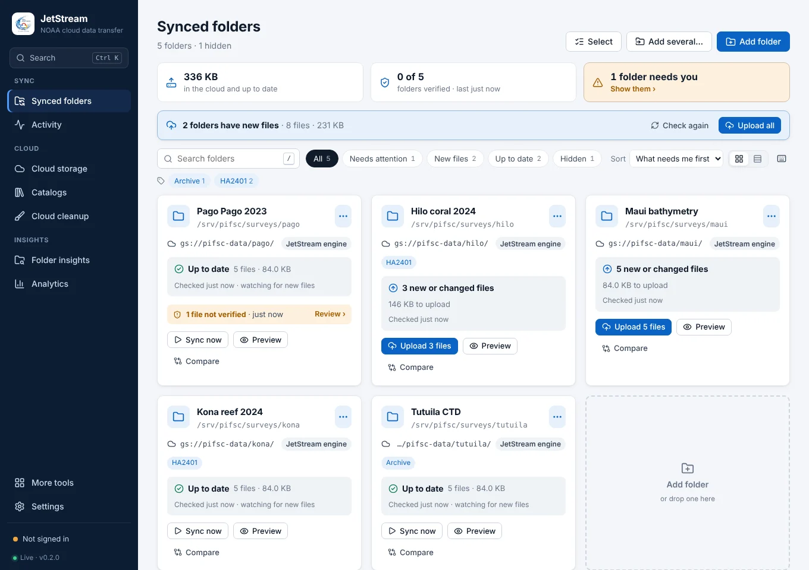
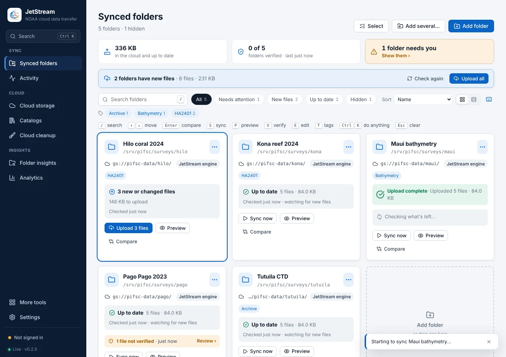
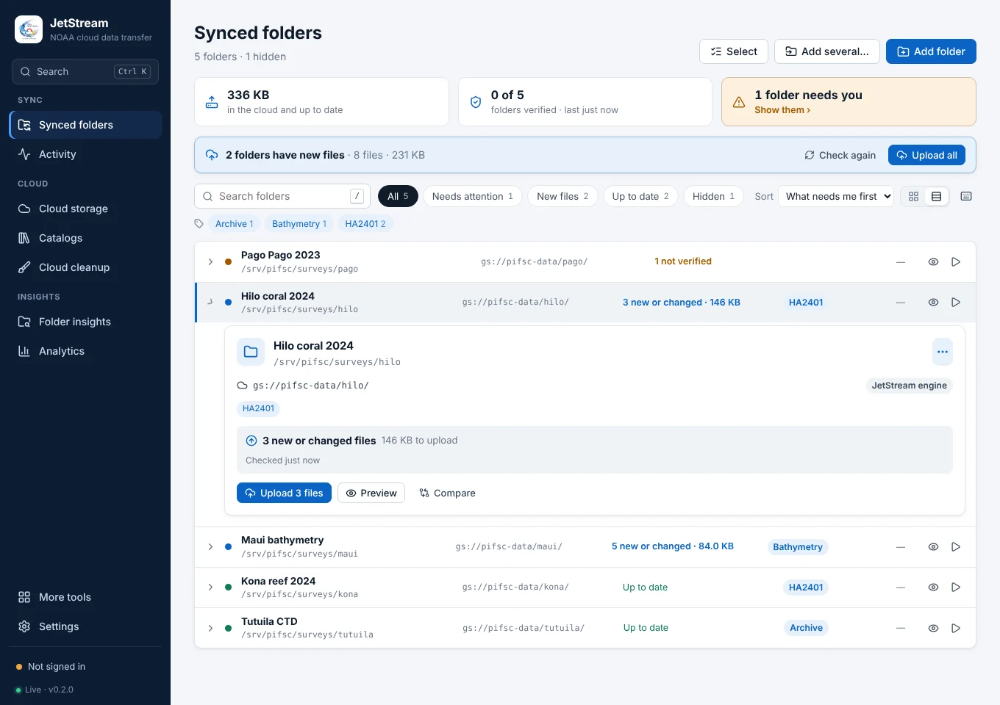
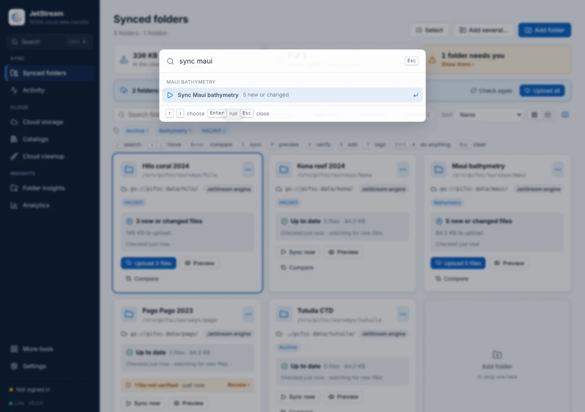
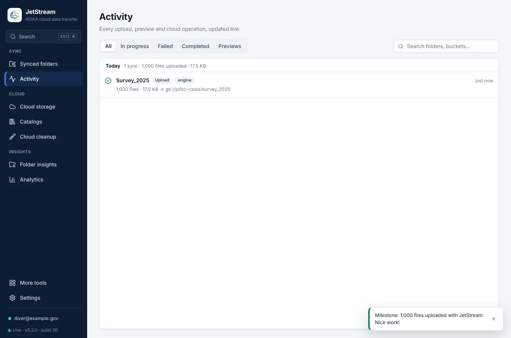

# Synced folders

Each folder you add is a card that always shows where it stands: up to date, new files waiting, syncing, or something that needs you.

{ .screen }

## At a glance

The summary at the top shows how much is in the cloud and up to date, how many folders are verified, and whether anything needs you. Click **Show them** to see just those folders.

A folder card shows:

- where it goes in the cloud, and the upload tool
- **what's new** since the last sync, checked in the background (no file reads), and **Upload N files**
- live progress, speed, time left and the file being uploaded while it runs, with **Pause** and **Cancel**
- **Upload complete:** what the last sync sent, how much and how fast
- **Verified · N files** with a link to the receipt (or, in amber, how many aren't verified)

{ .screen }

## Finding your way around many folders

Search
:   Press ++slash++ and type part of a name, path, bucket or tag.

Filters
:   **All · Needs attention · New files · Syncing · Up to date · Hidden**, each with a count.

Tags
:   Tag folders by project, cruise or season (**Tags…** in a folder's menu, or for several at once), then click a tag to show just those.

Hide
:   **Hide from the list** keeps finished projects out of the way. Hidden folders still sync on their schedule; find them under **Hidden**.

Sort
:   By what needs you first (the default), name, last synced, or most new files.

Cards or list
:   The compact list shows one row per folder. Click a row to expand it into its card.

{ .screen }

## Keyboard shortcuts

| Keys | Does |
| --- | --- |
| ++slash++ | Search |
| ++arrow-up++ ++arrow-down++ | Move between folders |
| ++enter++ | Expand (list) or compare (cards) |
| ++s++ / ++p++ / ++v++ | Sync / preview / verify the selected folder |
| ++e++ / ++t++ | Edit / tags |
| ++esc++ | Clear the search or filter |
| ++question++ | Show these |
| ++ctrl+k++ | Search or do anything |

## Search or do anything

++ctrl+k++ (++cmd+k++ on a Mac), or **Search** at the top of the sidebar, opens the command palette. Type a folder or an action: "sync kona", "receipt pago", "open hilo in cloud storage", "catalogs", "speed check", or paste a `gs://` path.

{ .screen }

## Several at once

**Select** puts a tick box on each card for **Upload**, **Preview**, **Check for changes**, **Tags**, **Auto-upload on/off**, **Hide** or **Remove**. **Upload all** in the bar at the top uploads every folder with new files, one after another.

## Activity

Every upload, preview and cloud operation, grouped by day with what each day uploaded. Click one for its details, files and log.

{ .screen }
