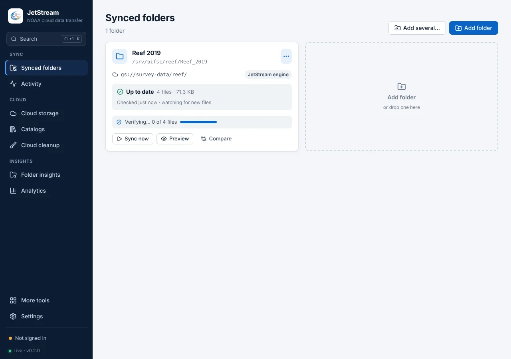
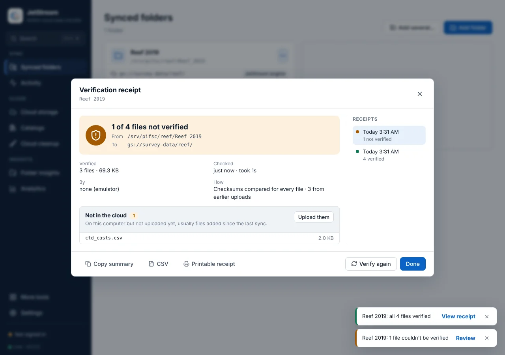

# Verification receipts

After each sync, JetStream checks every file in the folder against its copy in the cloud by checksum and keeps a **receipt**: proof, file by file, that your data arrived intact. Useful for data management plans, archiving and audits.

## Quiet by default

Verification runs in the background. The folder card shows **Verifying… 8,200 of 12,000 files**, then **Verified · 12,000 files**. You're only told if something isn't verified: the card turns amber (**3 files not verified · Review**) and a message says so.

{ .screen }

**Verify now** in a folder's menu runs one any time. Repeat receipts are quick: only files JetStream hasn't read before are read.

## The receipt

Click the verified line on a card (or a receipt on the Compare screen):

{ .screen }

- **The seal:** all files verified, or how many aren't.
- **From and to**, when, by which account, and how it was checked.
- **What isn't verified**, grouped by reason, each with what to do:

| Reason | What it means | What to do |
| --- | --- | --- |
| Not in the cloud | On this computer, not uploaded yet | **Upload them** |
| Different from the cloud | One copy changed after uploading | **Compare** |
| Couldn't be read | Locked or not permitted | Close programs using it, then verify again |
| Online-only (OneDrive) | Not on this computer | **Always keep on this device**, then verify again |

- **Earlier receipts** alongside, to compare over time.
- **Printable receipt:** opens a page in your browser to print or save as PDF.
- **CSV:** one row per file (path, status, size, CRC32C, MD5, cloud version, time), plus a JSON copy for tools.

## Where receipts are kept

In the JetStream data folder (`receipts/<folder name>/`), and optionally next to the data in the cloud (`_jetstream/receipts/`): turn on **Also keep a copy in the cloud** in the folder's settings.
