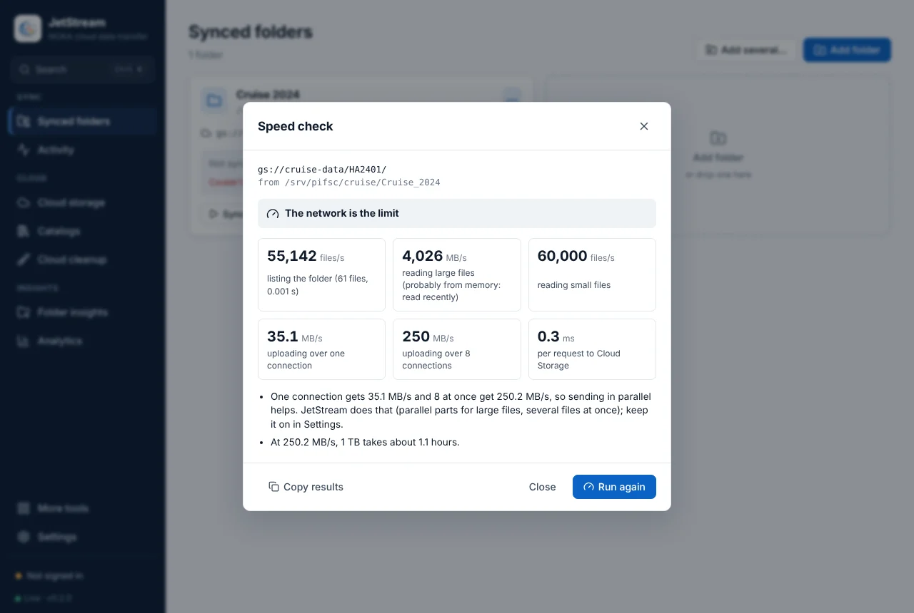

# Uploads and speed

## The JetStream engine or gcloud

Each folder can use either:

- **The JetStream engine** (recommended): remembers what it has uploaded so later syncs only read what changed, uploads large files in parallel parts, pauses and resumes at once, waits out internet drops, and records each file's type and original dates.
- **gcloud** (`gcloud storage rsync`): Google's own tool, if your workflow already depends on it.

Switching from gcloud to the engine is seamless: the first engine sync recognises files gcloud uploaded by size and date, without reading them again.

## Large files

Files over 256 MB go up as up to 32 parts at once and are joined in the bucket, often several times faster on long-distance connections. The joined file is checked against the original by CRC32C. Joined files have no MD5 checksum, so turn **Upload large files in parallel parts** off in Settings if your data needs MD5. It's skipped automatically for buckets with a retention policy or a Nearline, Coldline or Archive storage class.

## Pause, resume and internet drops

- **Pause** stops sending within a second, even in the middle of a large file; **Resume** carries on from there.
- **Cancel** stops just as quickly and keeps what's done, so the next run continues.
- **No internet?** The card says **Waiting for the internet connection**, and the upload carries on by itself when it's back, however long it was down, without failing files.

## Speed limit

**Settings → Uploads → Upload and download speed limit** keeps JetStream from using all of a shared or slow connection (for example on a ship). It applies to running uploads at once.

## Speed check

Uploads slower than you expected? **Speed check…** in a folder's menu measures, in about half a minute:

- how fast the folder lists and reads (big files and small ones)
- upload speed over one connection and over 8 at once
- the time each request to Cloud Storage takes

It then says what the limit is: the disk or share, the network, or per-file overhead. Nothing is stored in the bucket.

{ .screen }

## Network shares

Folders are read many at a time (16 at once for `\\server\share` paths), so listing a big share is quick, and later syncs only need that listing: what's already uploaded isn't read again.

## OneDrive

Online-only files ("files on demand") aren't on the computer, so they're skipped with a note. Right-click the folder and choose **Always keep on this device**, then sync again.
