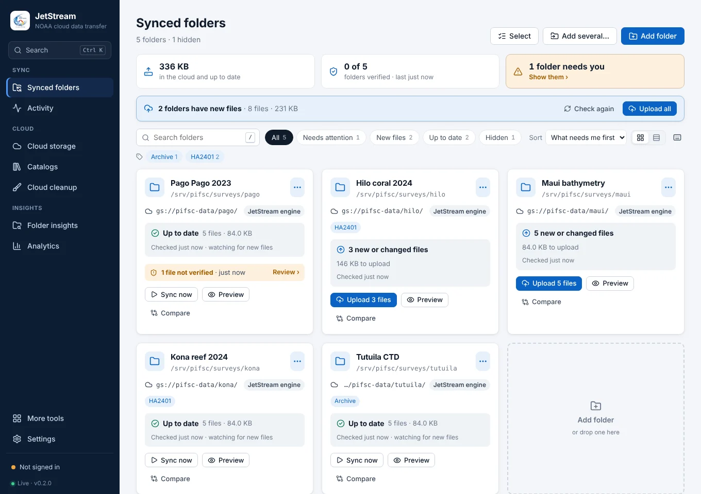
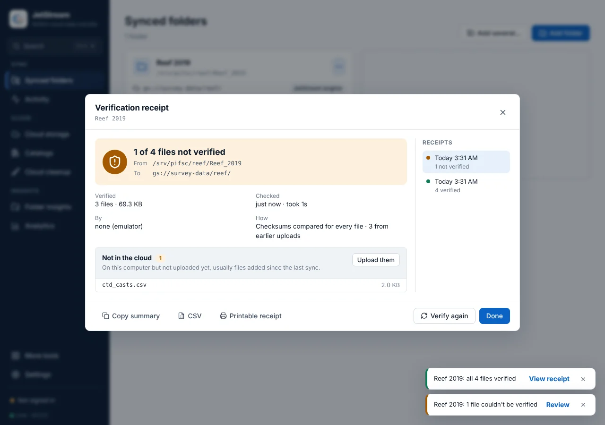
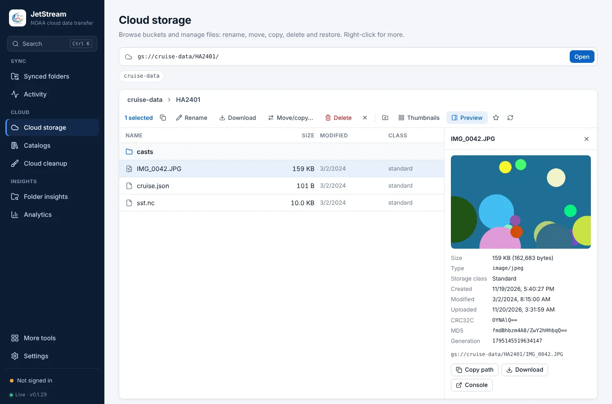
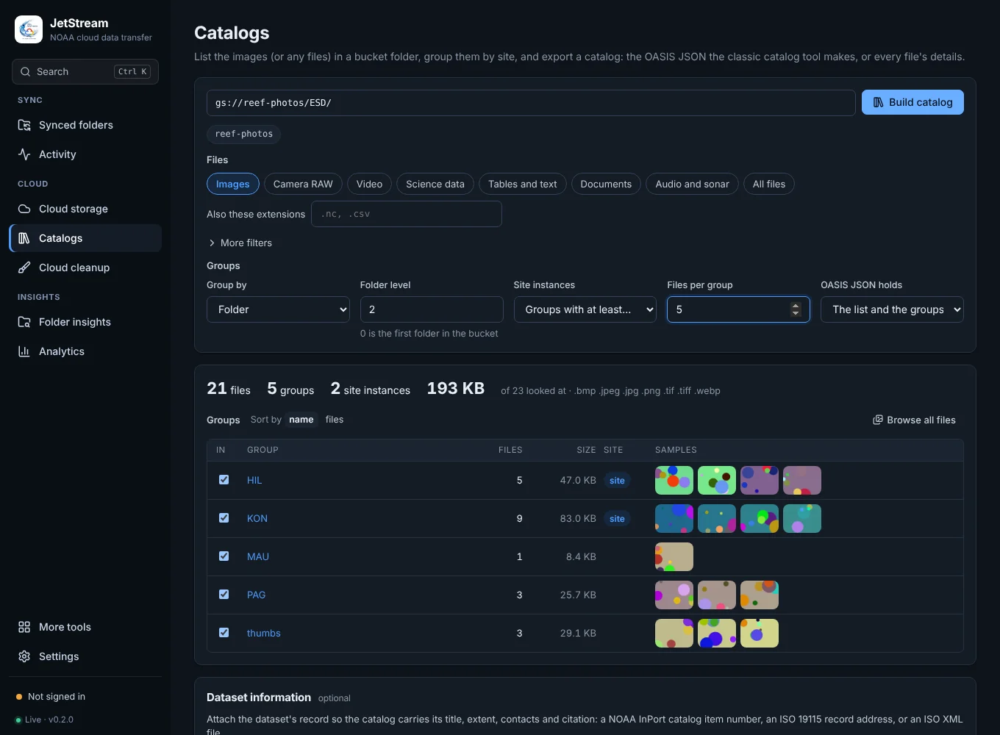
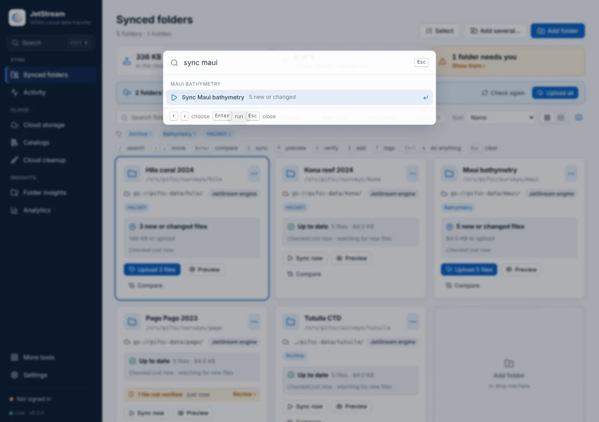
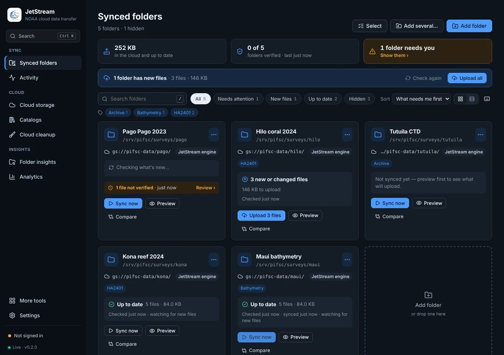

---
hide:
  - navigation
  - toc
---

# Your data in the cloud, verified

JetStream moves research data from your computer and network shares to Google Cloud Storage, keeps it in sync, and proves every file arrived intact.

[Download for Windows](download.md#windows){ .md-button .md-button--primary }
[Download for Linux](download.md#linux){ .md-button }
[Get started](getting-started.md){ .md-button }

{ .screen }

## Why JetStream

-   :material-folder-sync:{ .lg .middle } **Folders that keep themselves backed up**

    ---

    Add a folder once. JetStream notices new files within seconds and uploads only what's new, by itself if you like.

    [:octicons-arrow-right-24: Synced folders](guides/folders.md)

-   :material-shield-check:{ .lg .middle } **Proof it arrived**

    ---

    Every file is checked against the cloud by checksum after each sync, with a receipt you can open, print or attach to a data management plan.

    [:octicons-arrow-right-24: Verification receipts](guides/receipts.md)

-   :material-rocket-launch:{ .lg .middle } **Fast, even on bad connections**

    ---

    Large files go up in parallel parts. Pause and resume at once, and internet drops are waited out without failing files.

    [:octicons-arrow-right-24: Uploads and speed](guides/uploads.md)

-   :material-image-multiple:{ .lg .middle } **See what's in the cloud**

    ---

    Browse buckets with thumbnails and a preview pane, rename, move, copy and restore, and build catalogs for OASIS.

    [:octicons-arrow-right-24: Cloud storage](guides/cloud-storage.md)

-   :material-book-open-variant:{ .lg .middle } **Catalogs for OASIS and beyond**

    ---

    Group thousands of images by site, export the OASIS catalog or every file's details, and attach the dataset's InPort record.

    [:octicons-arrow-right-24: Catalogs](guides/catalogs.md)

-   :material-keyboard:{ .lg .middle } **Quick with many folders**

    ---

    Search, filters, tags and a compact list for dozens of folders, keyboard shortcuts throughout, and ++ctrl+k++ to do anything.

    [:octicons-arrow-right-24: Finding your way around](guides/folders.md#finding-your-way-around-many-folders)

## A quick tour

=== "Receipts"

    { .screen }

    What's verified, what isn't and what to do about it, with every earlier receipt alongside.

=== "Cloud storage"

    { .screen }

    Images, CSV tables and every detail Cloud Storage keeps, without downloading whole files.

=== "Catalogs"

    { .screen }

    Group thousands of images by site and export the OASIS catalog, or every file's details.

=== "Do anything (Ctrl+K)"

    { .screen }

    Type a folder or an action: "sync kona", "receipt pago", "catalogs".

=== "Dark mode"

    { .screen }

    Follows your system, or choose in Settings.

## Built for NOAA science

- **Your own Google sign-in.** No service account keys to manage; JetStream uses the account you sign in with.
- **Nothing leaves your control.** Data goes only to your buckets. The only other request JetStream makes is a daily check for a newer version, which you can turn off.
- **Works where you work.** Windows (installer or portable, no admin rights needed) and Linux. Network shares, OneDrive folders and USB drives.
- **Open source.** [See the code on GitHub](https://github.com/akridge/jetstream).
